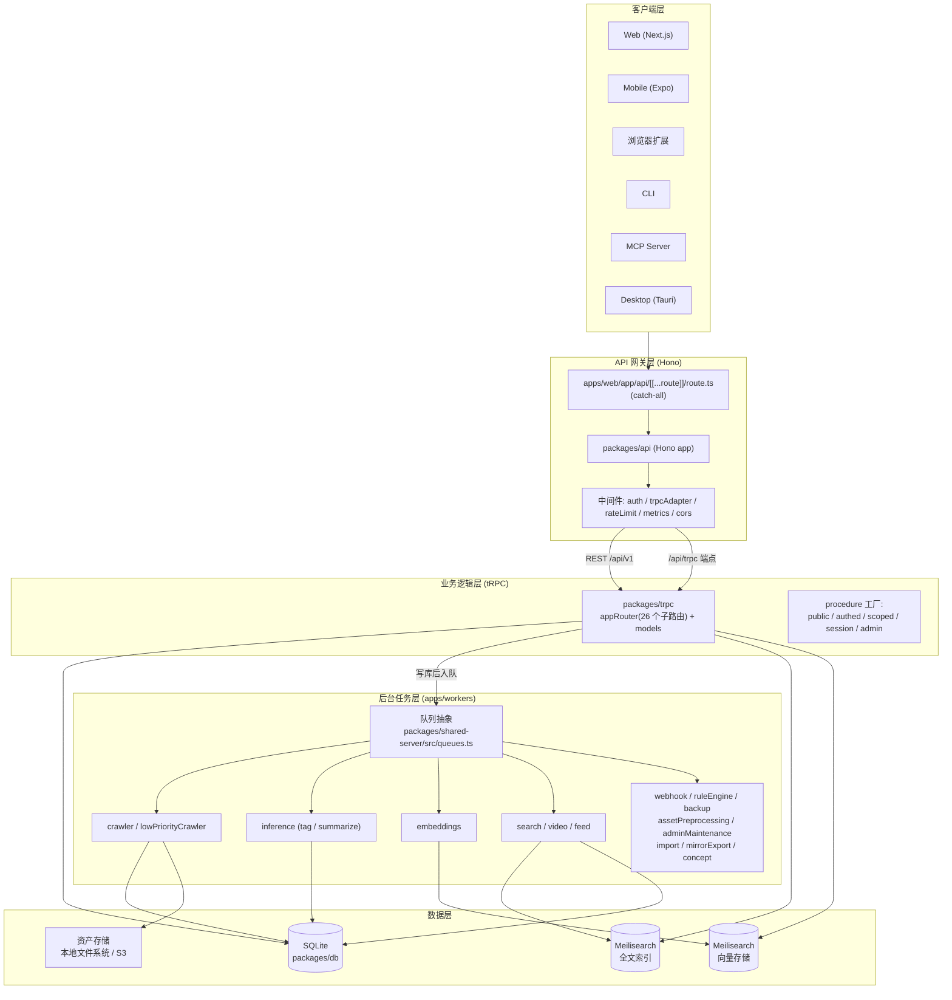
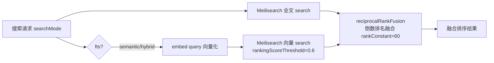
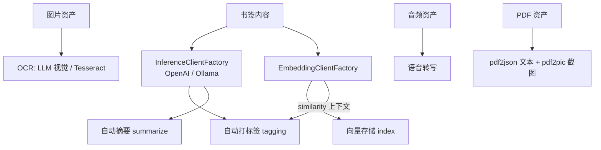
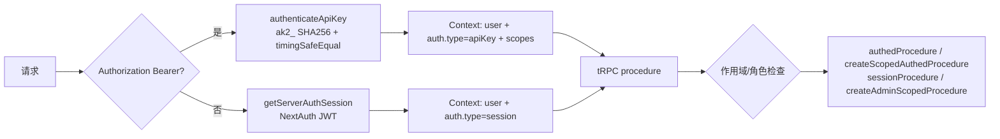

# 02 整体架构

## 1. 架构总览

Saiye 是典型的**分层 + 异步任务**架构:同步请求走"客户端 → API 网关 → tRPC 业务逻辑 → 数据库";耗时/可重试的工作通过队列分发给独立的 Workers 进程处理。



### 分层职责

| 层 | 关键包 | 职责 |
|---|---|---|
| 客户端 | `apps/web`, `apps/mobile`, `apps/browser-extension`, `apps/cli`, `apps/mcp`, `apps/desktop` | UI 与用户交互,复用 `@saiye/trpc` 的 AppRouter 类型 |
| API 网关 | `packages/api` + `apps/web/app/api/[[...route]]/route.ts` | Hono 路由、认证上下文注入、REST 与 tRPC 适配 |
| 业务逻辑 | `packages/trpc` | tRPC 路由、领域模型(models)、规则引擎、搜索排序 |
| 数据 | `packages/db`、Meilisearch、资产存储 | 持久化、全文索引、向量索引、二进制资产 |
| 后台任务 | `apps/workers` + `packages/shared-server` | 异步抓取、AI 推理、向量化、搜索索引、Webhook 等 |
| 共享基础 | `packages/shared` / `shared-react` / `plugins` | 配置、类型、插件体系、跨端 React 组件 |

## 2. 核心数据流:创建一个书签

以"用户保存一个链接"为例(源码:[packages/trpc/routers/bookmarks.ts](../packages/trpc/routers/bookmarks.ts) 的 `createBookmark` 与 [apps/workers/workers/crawlerWorker.ts](../apps/workers/workers/crawlerWorker.ts)):

```mermaid
sequenceDiagram
    participant Client as 扩展 / Web / CLI
    participant API as Hono (apps/web/api)
    participant TRPC as tRPC bookmarks.createBookmark
    participant DB as SQLite
    participant CQ as LinkCrawlerQueue
    participant CW as Crawler Worker
    participant IW as Inference Worker
    participant EW as Embeddings Worker
    participant SW as Search Worker
    participant MS as Meilisearch

    Client->>API: POST /api/v1/bookmarks (Bearer/API key 或 session)
    API->>TRPC: createContextFromRequest → ctx(user, auth)
    TRPC->>TRPC: attemptToDedupLink(url) 去重
    TRPC->>DB: 事务: 配额校验 + insert bookmarks/bookmarkLinks
    TRPC->>CQ: LinkCrawlerQueue.enqueue(bookmarkId, {priority, groupId})
    par 并行副作用
        TRPC->>DB: RuleEngine.triggerOnEvent(bookmarkAdded)
        TRPC->>TRPC: triggerSearchReindex(bookmarkId)
        TRPC->>TRPC: WebhooksService.triggerWebhook("created")
    end
    TRPC-->>Client: 返回 bookmark(已建,异步处理中)

    Note over CW: 爬虫异步执行
    CQ->>CW: dequeue 作业
    CW->>CW: 域名限流校验 + 选代理 + SSRF 校验
    CW->>CW: 无头 Chrome 抓取 / 元数据 / 截图 / PDF / 解析 HTML
    CW->>DB: 更新 bookmarkLinks(crawlStatus=success)
    CW->>IW: OpenAIQueue.enqueue(tag) + enqueue(summarize)
    CW->>EW: EmbeddingsQueue.enqueue(embed)(若开启自动索引)
    CW->>SW: triggerSearchReindex
    CW->>MS: 视频下载 / webhook("crawled")

    Note over IW,EW: AI 推理异步执行
    IW->>DB: 写入 tags / summary,更新 taggingStatus / summarizationStatus
    EW->>MS: 生成向量 → 派发 index 作业;并触发带向量的 tagging
    SW->>MS: 全文索引 addDocuments
```

### 关键实现细节

- **去重**:`createBookmark` 先按 `(url, userId)` 查重;已存在时,来源属于 `{rss, import}` 则幂等返回 `alreadyExists: true`;其余来源走"重新保存"路径(恢复归档、可选覆盖字段、置顶、触发重索引与 `edited` webhook)。
- **配额**:事务内调用 `QuotaService.canCreateBookmark`,超额抛 `FORBIDDEN`。
- **优先级队列**:高频创建(命中 5 分钟/30 次限流)或 `crawlPriority: "low"` 的请求走 `LowPriorityCrawlerQueue`,避免导入/RSS 挤占实时抓取并发。
- **三态状态机**:`bookmarks` 表的 `crawlStatus` / `taggingStatus` / `summarizationStatus` / `embeddingStatus` 均为 `pending | success | failure`,驱动 UI 轮询刷新与重试;worker 永久失败时会清理 pending 状态避免 UI 卡住。
- **爬虫后编排**:`enqueuePostCrawlJobs` 把优先级透传给所有子作业;按配置决定走"embeddings 链路(向量索引 + 带相似上下文的 tagging)"还是"直接 OpenAI tagging"。

## 3. 混合搜索架构

三种搜索模式(fts / semantic / hybrid),见 [packages/trpc/routers/bookmarks.ts](../packages/trpc/routers/bookmarks.ts) 的 `searchBookmarks`:



- **查询语法**:[packages/shared/searchQueryParser.ts](../packages/shared/searchQueryParser.ts) 基于 typescript-parsec 解析结构化查询(`is:fav`、`tag:xx`、`#tag`、`after:`、`age:`、`and/or`、取反等),matcher 经 [packages/trpc/lib/search.ts](../packages/trpc/lib/search.ts) 编译为 SQL id 集合过滤。
- **融合算法**:`reciprocalRankFusion`([packages/trpc/lib/searchRanking.ts](../packages/trpc/lib/searchRanking.ts))按排名倒数加权,刻意忽略异质分数,两源共同命中的结果自然居前。
- **语义限流**:非 fts 模式走独立限流(60s / 300 次)。

## 4. AI 推理管线



- **模型可插拔**:`INFERENCE_TEXT_MODEL` / `INFERENCE_IMAGE_MODEL` / `EMBEDDING_TEXT_MODEL` 等环境变量,支持 OpenAI 兼容端点与本地 Ollama([packages/shared/inference.ts](../packages/shared/inference.ts))。
- **用户可控**:`autoTaggingEnabled` / `autoSummarizationEnabled` / `tagStyle` / `curatedTagIds` / `inferredTagLang`,以及 `customPrompts` 自定义提示词注入。
- **embed → tag 联动**:向量化完成后把向量随 tagging 作业下发,使 AI 打标签可借助相似书签上下文;索引失败不影响 tagging。

## 5. 认证与授权



- **会话认证**:NextAuth v4,JWT 策略;凭据 Provider 调用 `validatePassword`(bcrypt 校验 `password + salt`)。登录路径用 `DUMMY_PASSWORD_HASH` 抹平时序,防用户枚举;登录限流 15 分钟 10 次。
- **OAuth**:自定义 OIDC Provider(`OAUTH_WELLKNOWN_URL`,仅信任非对称签名)与微信扫码。
- **API Key**:格式 `ak2_<keyId>_<secret>`(v2 SHA-256 + `timingSafeEqual`;v1 `ak1_` 为 bcrypt 旧格式);`scopes` 细粒度控制;`lastUsedAt` 10 分钟节流更新。
- **首个用户即 admin**:`User.createRaw` 中 `userCount === 0 ? "admin" : "user"`。
- **桌面本地模式**:`SAIYE_LOCAL_MODE=true` 时绕过 NextAuth,懒创建合成 admin 用户。

## 6. 关键设计决策

1. **Hono 挂载于 Next.js**:`apps/web/app/api/[[...route]]/route.ts` catch-all + `hono/vercel` 的 `handle`,让 Next.js 同时承担前端渲染与 API 网关;tRPC 走 `/api/trpc`,业务能力通过 `/api/v1` REST 暴露。
2. **tRPC 是业务逻辑单一来源**:REST 路由通过 `createCallerFactory(appRouter)` 生成的服务端 caller 复用 tRPC 逻辑,CLI/MCP/Worker(impersonating caller)同样复用,杜绝逻辑分叉。
3. **可插拔基础设施(Plugin 架构)**:搜索、向量、队列、限流四种能力抽象为接口 + 插件实现,`PluginManager` 按"后注册者胜"选择;自托管(内存/LiteQueue)与云部署(Redis/Restate/Meilisearch)无缝切换。
4. **状态机驱动的异步处理**:多组 `pending/success/failure` 字段精确反映各阶段进度。
5. **两阶段导入 + 低优先级队列隔离**:staging 表先落库,import worker 轮询公平消费(按用户轮转 + 用户内 FIFO + 原子认领),走低优先级爬取队列。
6. **安全细节**:API Key 恒定时间比较、SSRF 防护(禁用内网 IP 段 + DNS pinning 防 rebinding)、签名 URL(HMAC-SHA256 + timingSafeEqual)、OAuth 仅非对称签名、域名级爬虫限流 + 抖动退避。
7. **配额能力令牌**:`QuotaService.checkStorageQuota` → `QuotaApproved`(私有构造,编译期保证)→ `saveAsset` 强制校验,防止绕过配额直写存储。
8. **可观测性内建**:tRPC procedure 级指标 → worker 级 OTel tracing + 事件日志 → Prometheus 指标(web 与 workers 各自暴露)。
