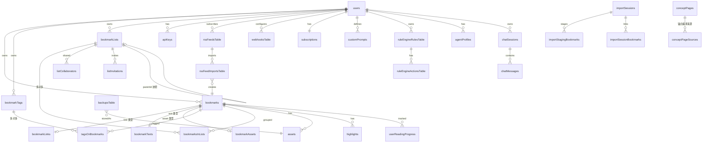

# 04 数据库设计(@saiye/db)

## 1. 概览

[packages/db](../packages/db) 是纯 SQLite 方言包:**better-sqlite3 同步驱动 + Drizzle ORM**。源码直出(无构建产物),被 `trpc` / `api` / `shared-server` / `web` / `workers` 依赖。

| 文件 | 职责 |
|---|---|
| [schema.ts](../packages/db/schema.ts) | 全部表定义(45+ 表)+ 28 个 relations,1624 行 |
| [drizzle.ts](../packages/db/drizzle.ts) | 数据库单例、SQLite pragma、**异步事务原型补丁** |
| [index.ts](../packages/db/index.ts) | 包入口:`db`、`DB` 类型、`schema` 命名空间、`SqliteError`、`SaiyeDBTransaction` |
| [migrate.ts](../packages/db/migrate.ts) | CLI 迁移入口(`pnpm db:migrate`) |
| [instrumentation.ts](../packages/db/instrumentation.ts) | `instrumentDatabase()`:包装 `sqlite.prepare()` 生成 OTel span |
| [drizzle.config.ts](../packages/db/drizzle.config.ts) | drizzle-kit 配置:dialect=sqlite,输出 `./drizzle/` |
| [drizzle/](../packages/db/drizzle) | 101 个迁移 SQL(0000~0100)+ meta journal |

## 2. 关键实现

### drizzle.ts —— 数据库初始化与异步事务补丁

```ts
// 伪代码摘要
export const db = drizzle(sqlite, { schema });          // 全局单例
export type DB = typeof db;
export function getInMemoryDB(runMigrations: boolean);  // 测试用 :memory: 库
```

- **`patchDatabaseTransactions()`**:better-sqlite3 ≥ 12 不允许事务回调返回 Promise,该补丁打在 `Database.prototype` 上使 drizzle 的**异步事务回调**可用 —— 顶层事务用 `begin {deferred|immediate|exclusive}/commit/rollback` + per-instance promise 链串行化;嵌套调用改用 SAVEPOINT。打在原型上是为了覆盖 liteque 等依赖内部创建的实例。
- **pragma 初始化**:按 `DB_WAL_MODE` 设 WAL+NORMAL 或 DELETE journal;`cache_size=-65536`(64MB)、`foreign_keys=ON`、`temp_store=MEMORY`。
- **字段工具函数**(schema.ts):`createdAtField` / `modifiedAtField` 等,秒级时间戳 + 默认当前时间 / 更新自动刷新。

### 迁移工作流

```bash
pnpm db:generate --name description_of_schema_change   # drizzle-kit 生成迁移
pnpm db:migrate                                        # 应用到 ${DATA_DIR}/db.db
pnpm db:studio                                         # Drizzle Studio 可视化
```

Docker 部署时 `init-db-migration` s6 服务在 web/workers 启动前自动运行迁移。

## 3. 实体关系图(核心)



## 4. 表清单(按域分组)

### 认证与账户

| 导出名 | 表 | 说明 |
|---|---|---|
| `users` | `user` | 用户主表:email 唯一、password+salt、role(admin/user);管理员设置(bookmarkQuota/storageQuota/browserCrawlingEnabled/manualTierName);用户偏好(阅读器/AI/备份/时区/标签风格等 15+ 字段) |
| `accounts` | `account` | Auth.js OAuth 账户,复合主键 (provider, providerAccountId) |
| `sessions` | `session` | 会话(JWT 策略下主要供 adapter 兼容) |
| `verificationTokens` | `verificationToken` | 验证令牌 |
| `passwordResetTokens` | `passwordResetToken` | 密码重置令牌(1 小时有效) |
| `apiKeys` | `apiKey` | API Key:keyId 唯一 + keyHash、scopes JSON(默认 full access)、lastUsedAt、unique(name,userId) |
| `invites` | `invites` | 邀请注册(email、token 唯一、invitedBy) |
| `subscriptions` | `subscriptions` | Stripe 订阅(stripeCustomerId/SubscriptionId、status 8 态、tier free/paid) |

### 书签核心

| 导出名 | 表 | 说明 |
|---|---|---|
| `bookmarks` | `bookmarks` | **核心表**:type(link/text/asset)、source 8 种(api/web/cli/mobile/extension/singlefile/rss/import)、crawlStatus/taggingStatus/summarizationStatus/embeddingStatus 三态、note、summary;复合索引优化 `userId+archived/favourited+lastSavedAt+id` 游标分页 |
| `bookmarkLinks` | `bookmarkLinks` | 链接详情(与 bookmarks 同 id 1:1):url、抓取元数据(title/author/publisher/datePublished/imageUrl/favicon/htmlContent/contentAssetId)、readerView 评估(status/score/reasons/classifierVersion)、crawlStatus、probeMetadataAt(重试跳过重复探测) |
| `bookmarkTexts` | `bookmarkTexts` | 文本内容(text、sourceUrl) |
| `bookmarkAssets` | `bookmarkAssets` | 资产书签(assetType image/audio/pdf、assetId、metadata、content — OCR/转写结果) |
| `assets` | `assets` | 二进制资产登记(13 种 AssetTypes:截图/PDF/整页归档/预抓归档/头像/备份/视频/上传文件等;size、contentType、bookmarkId 可空) |
| `highlights` | `highlights` | 高亮(startOffset/endOffset、color 四色、text、note) |
| `userReadingProgress` | `userReadingProgress` | 阅读进度(offset/anchor/percent,unique(bookmarkId,userId)) |

### 标签与列表

| 导出名 | 表 | 说明 |
|---|---|---|
| `bookmarkTags` | `bookmarkTags` | 标签:name、**normalizedName 生成列**(SQL 表达式 lower + 去空格/连字符/下划线,与 tagging 归一化逻辑保持同步)、unique(userId,name) |
| `tagsOnBookmarks` | `tagsOnBookmarks` | 书签-标签多对多(复合主键,attachedBy = ai/human) |
| `bookmarkLists` | `bookmarkLists` | 列表:type(manual/smart)、smart 的 query、parentId 自引用 set-null、public、rssToken |
| `bookmarksInLists` | `bookmarksInLists` | 书签-列表多对多;listMembershipId 关联协作成员资格,成员被移除时级联清理 |
| `listCollaborators` | `listCollaborators` | 协作者(role = viewer/editor) |
| `listInvitations` | `listInvitations` | 协作邀请(status = pending/declined) |

### AI / Chat / Agent 生态

| 导出名 | 表 | 说明 |
|---|---|---|
| `customPrompts` | `customPrompts` | 自定义 AI 提示词(appliesTo = all_tagging/text/images/summary) |
| `agentProfiles` | `agentProfiles` | Agent 档案:type = openai-compatible(baseUrl/apiKey/model)或 trae-cli(command/timeoutMinutes);systemPrompt、enableTools |
| `agentMemories` | `agentMemories` | Agent 长期记忆(content、sourceChatId 不设 FK — 会话删除后记忆保留) |
| `chatSessions` / `chatMessages` | `chatSessions` / `chatMessages` | AI 聊天会话与消息(role = user/assistant/toolResult、metadata JSON) |
| `canvases` | `canvases` | 画布(drawnix 元素,data JSON) |
| `widgets` / `widgetVersions` | `widgets` / `widgetVersions` | Chat 自定义组件(manifest + HTML code 仅客户端沙箱执行,status = draft/enabled;版本 append-only,回滚 = 复制为新版本) |
| `sharedAgentAssets` | `sharedAgentAssets` | Agent 资产分享链接(快照语义,payload 不含 apiKey,源删除后仍有效) |
| `conceptPages` / `conceptPageSources` | `conceptPages` / `conceptPageSources` | 概念页:LLM 编译的知识摘要,锚定 tag/list(不设 FK,孤儿由对账 cron 清理);status = pending/generating/ready/stale/failure;sourceContentHash 用于 stale 检测;slug 唯一 |

### 自动化与运维

| 导出名 | 表 | 说明 |
|---|---|---|
| `rssFeedsTable` / `rssFeedImportsTable` | `rssFeeds` / `rssFeedImports` | RSS 订阅(enabled、importTags、lastFetchedStatus)/ 条目去重导入记录(unique(rssFeedId, entryId)) |
| `webhooksTable` | `webhooks` | Webhook 配置(events JSON:created/edited/crawled/ai tagged/deleted、token) |
| `ruleEngineRulesTable` / `ruleEngineActionsTable` | `ruleEngineRules` / `ruleEngineActions` | 规则引擎(event、condition JSON、actions:加/删标签、加/出列表、下载归档、收藏、归档;复合外键 (userId, tagId/listId) 保证归属) |
| `importSessions` 等 | `importSessions` 等 | 两阶段导入:会话(status 状态机 + 进度计数)、已建书签关联、暂存表(staging,status + result = accepted/rejected/skipped_duplicate) |
| `backupsTable` | `backups` | 备份记录(assetId、size、bookmarkCount、status) |
| `config` | `config` | 全局 KV 配置 |

> Relations(第 1299-1624 行)定义了 28 个 `relations()`,供 `db.query.*` 关系查询 API 使用。

## 5. 设计亮点

1. **`createdAt` 字段名与列名刻意不一致**:schema.ts:216-225 注释 —— 字段 `createdAt` 实际映射列 `lastSavedAt`(重新保存即置顶,排序/过滤用"最后保存时间"),不可变的首次创建时间在字段 `dbCreatedAt`(对外暴露为 `firstCreatedAt`)。
2. **`normalizedName` 生成列**:SQL 表达式自动归一化标签名,配合 unique 约束避免大小写/分隔符重复;需与业务层 `normalizeTagName` 保持同步。
3. **复合索引服务分页**:`bookmarks_userId_archived_lastSavedAt_id_idx` 等直接服务于 keyset 游标分页(bookmarks.ts 的 `loadMulti`)。
4. **type 分表设计**:link/text/asset 各自详情表共享 bookmark.id(1:1),主表只放公共字段。
5. **协作成员关系级联**:`bookmarksInLists.listMembershipId` 关联 `listCollaborators`,成员退出自动清理其添加的条目。
6. **规则表复合外键**:(userId, tagId) 复合外键在数据库层面防止规则引用他人资源。
7. **删除策略分层**:用户资源级联删除;agentMemories/conceptPages 锚点刻意不设 FK,配合应用层对账。
