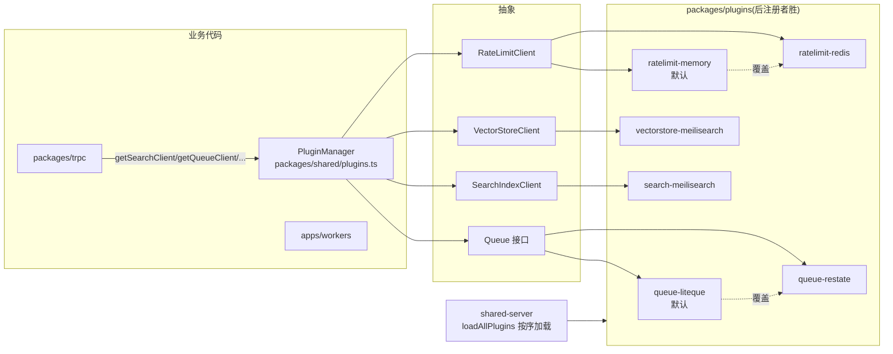

# 09 共享基础库

四个共享包构成"接口抽象 + 实现 + 跨端复用"的基础设施层。

## 1. @saiye/shared —— 全栈共享基础库

[packages/shared](../packages/shared),通过子路径(`@saiye/shared/config` 等)直接引用文件。

### 1.1 配置([config.ts](../packages/shared/config.ts))

- Zod schema 解析全部 `process.env`(**150+ 环境变量**),`serverConfigSchema.transform(...)` 产出嵌套只读 `serverConfig`:`auth`(OAuth/微信/Turnstile/本地模式)、`inference`、`embedding`、`crawler`、`ocr`、`chat`、`assetStore`(filesystem/s3)、`stripe`、`quotas`(free/paid)、`tracing`、`eventLogs`、`redis`、`mirrorExport` 等;
- 交叉校验(如邮箱验证需 SMTP、embedding 维度覆盖必须一致等);
- `clientConfig`:显式白名单挑选字段下发客户端,防泄漏。

### 1.2 四大可插拔抽象

| 模块 | 接口 | 关键方法 |
|---|---|---|
| [queueing.ts](../packages/shared/queueing.ts) | `Queue<T>` / `QueueClient` / `Runner` / `DequeuedJob` | `enqueue(payload, {idempotencyKey, priority, delayMs, groupId})`、`stats()`、`createQueue/createRunner`;`QueueRetryAfterError`(限流场景不计重试次数);`getQueueClient()` |
| [search.ts](../packages/shared/search.ts) | `SearchIndexClient` | `addDocuments`、`deleteDocuments`、`search`(filter eq/in、sort、matchingStrategy)、`clearIndex`;`zBookmarkSearchDocument`;`getSearchClient()` |
| [vectorStore.ts](../packages/shared/vectorStore.ts) | `VectorStoreClient` | `addVectors`、`deleteVectors`、`search`(rankingScoreThreshold)、`findSimilar`、`clearIndex`;`getVectorStoreClient()` |
| [ratelimiting.ts](../packages/shared/ratelimiting.ts) | `RateLimitClient` | `checkRateLimit(config, key)`(返回 resetInSeconds)、`reset`、`clear`;`getRateLimitClient()` |

### 1.3 插件注册中心([plugins.ts](../packages/shared/plugins.ts))

`PluginType { Search, Queue, RateLimit, VectorStore }`;`PluginManager`(状态挂 `globalThis` 防 Next.js 多 chunk 重复实例):`register()`(同名去重)、`getClient(type)`(**后注册者胜出**)、`isRegistered`。

### 1.4 AI 推理客户端([inference.ts](../packages/shared/inference.ts))

- `InferenceClientFactory.build()`:按 config 优先 OpenAI 兼容,其次 Ollama,否则 null;
- `EmbeddingClientFactory.build()`:支持独立 embedding 配置,回退 Inference;
- `OpenAIInferenceClient`:结构化输出(zodResponseFormat)、service_tier/reasoning_effort、语音转写;`OllamaInferenceClient`:流式 generate + Zod4 `z.toJSONSchema` 结构化输出(含流式中断 bug workaround);
- 接口:`inferFromText` / `inferFromImage` / `inferFromAudio` / `generateEmbeddingFromText`。

### 1.5 资产存储([assetdb.ts](../packages/shared/assetdb.ts))

- `AssetStore` 接口:`saveAsset` / `saveAssetFromFile` / `readAsset`(Range)/ `createAssetReadStream` / `readAssetMetadata` / `deleteAsset` / `deleteUserAssets` / `getAllAssets`(AsyncGenerator);
- 实现:`LocalFileSystemAssetStore`(`{dataDir}/assets/{userId}/{assetId}/asset.bin + metadata.json`)与 `S3AssetStore`(metadata 存 `x-amz-meta-*`);
- **`saveAsset` 强制校验 `QuotaApproved` 令牌**(userId 匹配 + 大小不超批准值),防止绕过配额直写。

### 1.6 其他核心模块

| 模块 | 职责 |
|---|---|
| [signedTokens.ts](../packages/shared/signedTokens.ts) | HMAC-SHA256 签名 token:`createSignedToken` / `verifySignedToken`(timingSafeEqual + schema 二次校验)、`getAlignedExpiry` |
| [searchQueryParser.ts](../packages/shared/searchQueryParser.ts) | 搜索语法解析器(typescript-parsec):`is:/url:/list:/after:/before:/age:/feed:/title:/tag:/source:`、`#tag`、引号、取反、括号、and/or;输入未敲完返回 partial(用于自动补全) |
| [storageQuota.ts](../packages/shared/storageQuota.ts) | `QuotaApproved` 能力令牌(私有构造) |
| import-export/ | `parseImportFile`(11 种来源:html/pocket/linkwarden/omnivore/tab-session-manager/mymind/readwise-reader/instapaper/onetab/matter/saiye → 统一 `ParsedBookmark` 中间表示);`importBookmarksFromFile`(依赖注入宿主能力,重建列表层级,50 条/批 staging);`toExportFormat` / `toNetscapeFormat` |
| types/ | **21 个 Zod schema 文件**(bookmarks/tags/lists/users/search/rules/highlights/feeds/webhooks/admin/apiKeys/...),同时驱动 tRPC 校验、OpenAPI 生成与 SDK 类型 |
| utils/ | bookmarkUtils(加载状态判断/刷新间隔)、tag(归一化 + AI 提示词构造)、listUtils(树构建)、reading-progress-dom、htmlUtils、url(SSRF)、redirectUrl(开放重定向防护)、relativeDateUtils 等 13 个 |

## 2. @saiye/shared-react —— 跨端 React 层

[packages/shared-react](../packages/shared-react),被 web 与 mobile 复用。

- [trpc.ts](../packages/shared-react/trpc.ts):`createTRPCContext<AppRouter>()` → `TRPCProvider / useTRPC / useTRPCClient`;
- providers:`trpc-provider.tsx`(SSR 安全 QueryClient,httpBatchLink → `{address}/api/trpc`,Bearer,30s 超时)、`client-config-provider.tsx`(服务端 clientConfig 与安全默认值逐组 merge);
- **hooks(16 个文件)**:bookmarks(`useAutoRefreshingBookmarkQuery` 按处理状态自动轮询、`useCreateBookmark`、级联 post-hook...)、lists、tags(`useTagAutocomplete`)、users、highlights、assets、rules、`useReadingProgress`、`useReaderSettings`、`useSearchHistory`、`scheduleInvalidateQueries`(防抖批量失效)、`useDebounce` 等;
- components:`BookmarkHtmlHighlighter`(HTML 上选取高亮 + 颜色/备注/删除 Popover)、`ScrollProgressTracker`(节流跟踪、懒保存 5s、Medium 式进度条)、`HIGHLIGHT_COLOR_MAP`。

## 3. @saiye/shared-server —— 服务端共享逻辑

[packages/shared-server](../packages/shared-server)。

| 模块 | 职责 |
|---|---|
| [src/queues.ts](../packages/shared-server/src/queues.ts) | **14 条业务队列定义**(见 [07-后台任务系统](./07-后台任务系统.md) §2)+ trigger 辅助函数 |
| [src/plugins.ts](../packages/shared-server/src/plugins.ts) | `loadAllPlugins()`:按序动态 import 六个插件包,后注册者胜,完成 `logAllPlugins()` |
| [src/eventLogger.ts](../packages/shared-server/src/eventLogger.ts) | 事件日志:全局单例,winston JSON 或 OTLP OTel 导出;`AsyncLocalStorage` 事件上下文;`logEvent` / `initEventLogger` / `shutdownEventLogger` |
| [src/tracing.ts](../packages/shared-server/src/tracing.ts) | `initTracing(serviceSuffix)`:NodeTracerProvider + OTLP HTTP exporter(或开发 Console),ParentBased 采样 |
| [src/services/quotaService.ts](../packages/shared-server/src/services/quotaService.ts) | `QuotaService`:`canCreateBookmark`(数量配额)、`checkStorageQuota → QuotaApproved`(能力令牌)、`getCurrentStorageUsage`;`StorageQuotaError` |

## 4. @saiye/plugins —— 可插拔后端实现

[packages/plugins](../packages/plugins),公共模式:插件根 index 在"已配置"时 `PluginManager.register(...)`;[lib/batchingDocumentQueue.ts](../packages/plugins/lib/batchingDocumentQueue.ts) 提供 Meilisearch 写入合批器(Mutex + 批量/超时双触发)。

| 插件 | 后端 | 要点 |
|---|---|---|
| queue-liteque | SQLite(`{dataDir}/queue.db`) | **无条件注册,默认队列**;基于 liteque(SqliteQueue/Runner/migrateDB);映射 QueueRetryAfterError ↔ liteque RetryAfterError |
| queue-restate | Restate(分布式) | `RESTATE_LISTEN_PORT` 配置时注册(晚于 liteque 故胜出);每条队列生成 dispatcher(信号量并发控制 + 重试策略 + rate_limit 延迟重排)与 runner(执行用户函数,超时 AbortSignal)一对服务;`RestateSemaphore` 基于虚拟对象实现租约/优先级/分组公平调度 |
| ratelimit-memory | 进程内 Map | 无条件注册;固定窗口 + 概率性清理(1%) |
| ratelimit-redis | Redis | `REDIS_URL` 配置时注册;**Lua 脚本原子滑动窗口**(ZSET);Redis 故障 fail-open 放行并节流告警 |
| search-meilisearch | Meilisearch | 写入经合批器(重试路径可绕过并 `ensureTaskSuccess` 轮询);filter 表达式、matchingStrategy "all" |
| vectorstore-meilisearch | Meilisearch 向量 | 文档 `{id, userId, _vectors: {default: vector}}`;`semanticRatio: 1.0` 纯向量检索;同走合批器 |

## 5. 插件体系贯穿图

后端选择对业务代码完全透明:web/workers 启动时 `loadAllPlugins()` 一次注册,业务侧仅通过 `getXxxClient()` 工厂取用。
