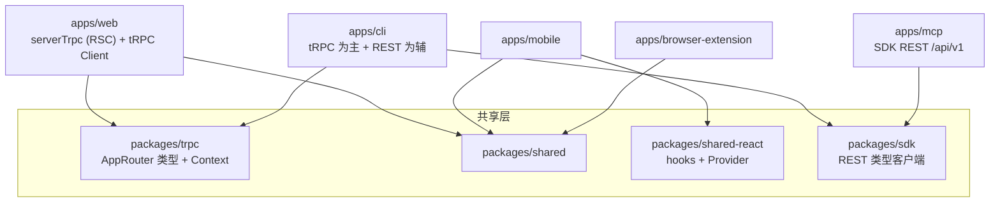

# 10 客户端应用

所有客户端共享同一份 tRPC 类型与部分前端逻辑,实现"一次定义,多端复用":

## 1. apps/cli —— 命令行客户端([apps/cli](../apps/cli))

- 包名 `@saiye/cli`,bin 名 **`saiye`**;commander(@commander-js/extra-typings)+ Vite 打包;
- 全局选项:`--api-key`(`SAIYE_API_KEY`)、`--server-addr`(`SAIYE_SERVER_ADDR`,默认 `http://localhost:3000`)、`--json`;配置持久化 `$XDG_CONFIG_HOME/saiye/config.json`(zod 校验);`auth init` 交互式写入配置。

| 命令 | 子命令 |
|---|---|
| `bookmarks` | add(link/note/asset/stdin)、import-singlefile、get、content(分块 markdown/text)、update、update-tags、list、search(fts/semantic/hybrid)、delete |
| `tags` | list、get、merge、delete |
| `lists` | list、create、delete、get、add-bookmark、remove-bookmark |
| `highlights` | list、get、delete |
| `assets` | download |
| `admin` | users list;bookmarks debug/recrawl/reindex/regenerate-embedding/retag/resummarize;jobs stats/recrawl-links/reindex-all/retag-all/resummarize-all/regenerate-embeddings/reprocess-assets(支持 --modified-within);subscriptions sync(SAIYE_CLOUD=1) |
| 其他 | `whoami`、`migrate`(跨服务器迁移)、`wipe`(清空服务端数据)、`dump`(导出账户归档) |

**连接方式**:主体走 tRPC(`createTRPCClient<AppRouter>` + httpBatchLink → `/api/trpc`,superjson,Bearer);少数命令直接 fetch REST(`/api/v1/assets`、`/api/v1/bookmarks/singlefile`、`/api/v1/bookmarks/{id}/content`)。

## 2. apps/mcp —— MCP 服务器([apps/mcp](../apps/mcp))

- 包名 `@saiye/mcp`,bin `saiye-mcp`;`@modelcontextprotocol/sdk` + **stdio 传输**,只暴露 tools;
- 走 `@saiye/sdk` 的 OpenAPI 类型化 REST(`/api/v1`,Bearer `SAIYE_API_KEY`,支持 `SAIYE_CUSTOM_HEADERS` 如 CF Access 头);
- **29 个工具**:bookmarks ×7(search/get/create/update/delete/content/lists)、lists ×8(含智能列表按保存 query 求值)、tags ×7、highlights ×6(按可读内容字符偏移创建)、assets ×1(签名下载 URL);
- 提供 Claude Desktop 的 npx 与 Docker 两种接入示例(README)。

## 3. apps/browser-extension —— 浏览器扩展([apps/browser-extension](../apps/browser-extension))

- **Manifest V3**(v1.2.11):权限 storage/tabs/contextMenus/activeTab/scripting,`optional_host_permissions: <all_urls>` 运行时按需申请;popup 为 React SPA(hash 路由区分 popup/options);service worker 注册右键菜单与快捷键(Ctrl+Shift+E);Firefox gecko id `addon@saiye.app`;
- 构建:@crxjs/vite-plugin(`VITE_BUILD_FIREFOX` 切换双端)+ react-swc;依赖 **single-file-core** 整页捕获;
- 通信:tRPC client(httpBatchLink → `/api/trpc`,Bearer API key + 自定义头,superjson),**与 web 端共用 AppRouter 类型**;TanStack Query + chrome.storage 持久化徽章缓存;
- 核心页面:SavePage / OptionsPage / SignInPage / CustomHeadersPage / BookmarkSaved(Deleted)Page;SingleFile 归档作为 `precrawledArchiveId` 上传。

## 4. apps/mobile —— Expo 移动端([apps/mobile](../apps/mobile))

- 技术栈:Expo 56 + React Native 0.85.3 + React 19 + expo-router + NativeWind 4.2 + TanStack Query(持久化)+ Sentry/MMKV/zustand;
- [app.config.js](../apps/mobile/app.config.js):应用名 Saiye(scheme `saiye`)、version 1.10.0、iOS bundle `app.saiye.mobile`、Android targetSdk 36;插件:expo-share-intent(系统分享接收 URL/图片/PDF)、expo-audio(语音笔记转写)、expo-secure-store、本地证书信任插件等;EAS 构建;
- 路由(app/):根级(signin / server-address / sharing 分享接收页)+ dashboard((tabs) 主列表、bookmarks/new、lists/new、tags/[slug]、canvas、chats/[id]、settings/*、archive、favourites);
- 复用 `@saiye/shared-react` hooks 与高亮组件;支持自建服务器地址、离线缓存(offlineCache/offlineLibrary)。

## 5. apps/landing —— 官网落地页([apps/landing](../apps/landing))

Astro 6 + @astrojs/react 岛组件 + 共享 tailwind 配置;静态页:首页 / apps / pricing / privacy / terms;React 组件:Homepage、Navbar、Pricing、FeatureShowcase、Platforms 等;public/ 含产品截图与各平台商店徽章。

## 6. apps/desktop —— Tauri 桌面壳([apps/desktop](../apps/desktop))

**Tauri 2**(非 Electron):

- `main.rs`:托盘菜单(打开/数据目录/日志/开机自启/退出)、全局快捷键 Alt+Shift+K、关窗隐藏到托盘(服务继续运行)、单实例与自启动插件;`supervisor::start()` 启动进程监督者;
- [scripts/dev.mjs](../apps/desktop/scripts/dev.mjs):开发态 Node 版 supervisor —— 管理 meilisearch/web/workers 三个子进程,单实例锁、崩溃指数退避重启(1/2/4/8/16s)、按日滚动日志保留 14 天、`/health` 探测、优雅退出(workers → web → meili);
- 打包:NSIS 安装器(Windows,中英双语),bundle 内嵌 `payload.tar.gz`(web 产物);设计文档 [DESKTOP_PHASE0_DESIGN.md](../docs/DESKTOP_PHASE0_DESIGN.md)。
