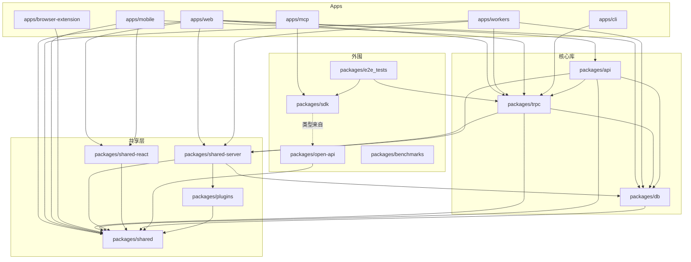
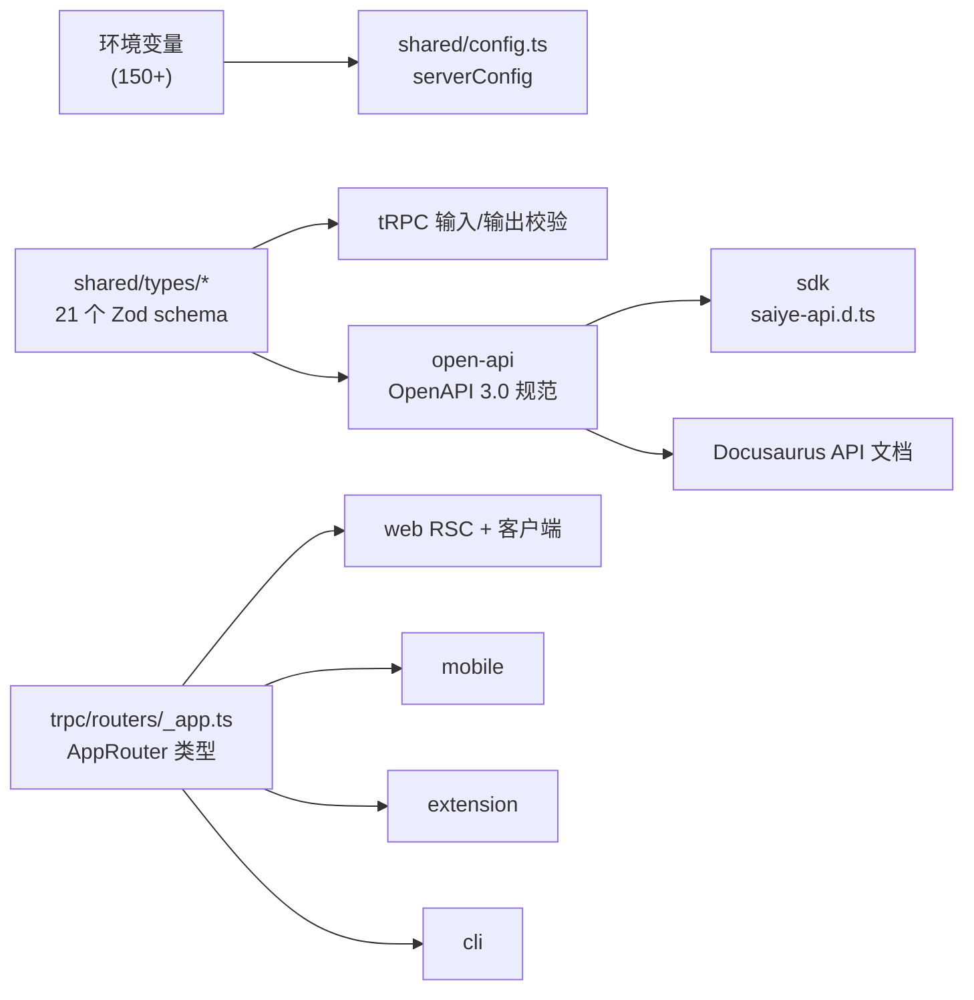

# 11 依赖关系

## 1. 内部包依赖图

## 2. 依赖关系明细

| 包 | 依赖的内部包 | 说明 |
|---|---|---|
| `@saiye/db` | `@saiye/shared`(serverConfig) | 最底层,仅取 dataDir 等配置 |
| `@saiye/shared` | —(无内部依赖) | 零内部依赖的基础库 |
| `@saiye/plugins` | `@saiye/shared` | 实现四大抽象接口 |
| `@saiye/shared-server` | `@saiye/shared`、`@saiye/db`、`@saiye/plugins`(动态 import) | 队列定义、插件加载、配额 |
| `@saiye/trpc` | `@saiye/db`、`@saiye/shared`、`@saiye/shared-server` | 业务逻辑核心 |
| `@saiye/api` | `@saiye/trpc`、`@saiye/db`、`@saiye/shared`、`@saiye/shared-server` | Hono 外壳,tRPC 内核 |
| `@saiye/shared-react` | `@saiye/shared`、(peer: @tanstack/react-query、@trpc/*) | 跨端 React |
| `@saiye/web` | api、trpc、db、shared、shared-react、shared-server + tooling(tsconfig/tailwind) | 主应用,聚合一切 |
| `@saiye/workers` | trpc、db、shared、shared-server | 后台任务 |
| `@saiye/open-api` | `@saiye/shared`(types) | Zod schema → OpenAPI |
| `@saiye/sdk` | openapi-fetch + open-api 生成的类型 | 外部客户端 |
| `@saiye/cli` | `@saiye/trpc`(AppRouter 类型) | tRPC 直连 |
| `@saiye/mcp` | `@saiye/sdk` | REST 直连 |
| `@saiye/mobile` | shared、shared-react、trpc(类型) | Expo |
| `@saiye/e2e_tests` | sdk + trpc | 双通道验证 |

## 3. 类型单一来源(Source of Truth)

- **schema 同源**:同一份 Zod schema 驱动 tRPC 校验、REST 文档与 SDK 类型,三层产物不会漂移(open-api 有 CI 漂移检查);
- **AppRouter 单源**:`export type AppRouter = typeof appRouter` 被 web/mobile/extension/cli 导入,服务端改接口客户端编译期即报错。

## 4. 关键外部依赖选型

| 领域 | 库 | 用途 |
|---|---|---|
| Web 框架 | next 16、react 19.2.3 | App Router、RSC、standalone 输出 |
| API | hono、@trpc/server v11、superjson | Hono 路由 + 端到端类型安全 RPC |
| ORM/DB | drizzle-orm、better-sqlite3 | SQLite 方言 + 同步驱动(异步事务经原型补丁) |
| 认证 | next-auth v4、@auth/drizzle-adapter、bcryptjs | JWT 会话 + OAuth |
| 搜索 | meilisearch | 全文 + 向量混合 |
| AI | openai、ollama | 推理客户端双后端 |
| 队列 | liteque(默认)、@restatedev/restate-sdk(分布式) | 队列插件 |
| 抓取 | playwright + playwright-extra + stealth、@ghostery/adblocker-playwright、@duckduckgo/autoconsent、metascraper 系 | 无头浏览器渲染与元数据 |
| 文档处理 | tesseract.js(OCR)、pdf2json、pdf2pic、@mozilla/readability、dompurify、turndown、cheerio | 内容提取与转换 |
| 视频 | yt-dlp(外部二进制,经 execa) | 视频下载 |
| UI | tailwindcss、radix 系、lucide-react、sonner、next-themes | shadcn/ui 体系 |
| 编辑器 | lexical、@plait/* + @drawnix/drawnix、slate(遗留) | Markdown/白板 |
| 流式 | ai v6、streamdown 系 | AI 聊天渲染 |
| 状态 | @tanstack/react-query、zustand、nuqs | 服务端/客户端/URL 状态 |
| i18n | i18next、react-i18next | 32 语言 |
| 可观测 | @opentelemetry/*、prom-client、winston、sentry | tracing/指标/日志 |
| 支付 | stripe | 订阅配额 |
| 邮件 | nodemailer | 验证/邀请/重置 |
| 桌面 | tauri 2 | 桌面壳 |
| 构建 | turbo、tsdown、vite、tsx | Monorepo 任务与打包 |

## 5. pnpm workspace 治理要点([pnpm-workspace.yaml](../pnpm-workspace.yaml))

- `nodeLinker: hoisted` + `allowBuilds` 白名单(better-sqlite3/sharp/tesseract.js 等原生模块允许构建脚本);
- **patchedDependencies** 8 个:react-native(禁用 dev 组件性能序列化,修复 tRPC proxy crash)、react-native-css-interop、expo-modules-jsi(Swift 6.2 兼容)、@drawnix/drawnix、playwright-extra、react-tweet、xcode;
- **overrides** 统一关键版本:react/react-dom 19.2.3(RN 渲染器要求全仓一致)、@plait/* 0.93.4(drawnix instanceof 检查要求单版本)、vite 7.0.6;
- Sherif 负责 monorepo 依赖规则检查(如同一依赖版本一致性)。
