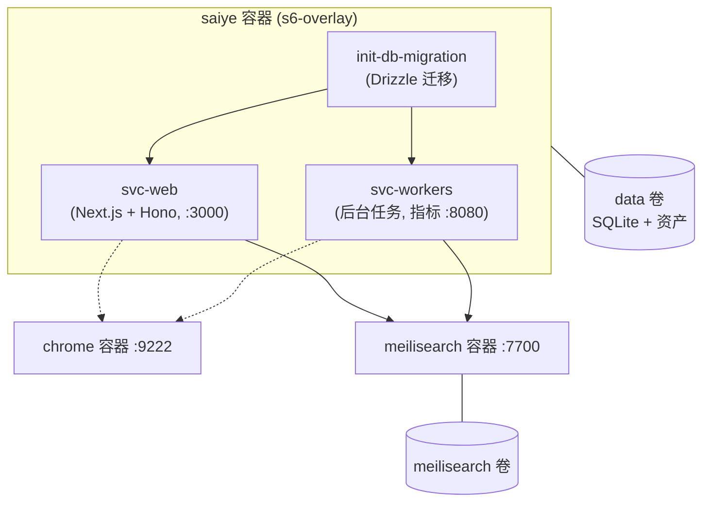

# 12 开发与运行指南

## 1. 环境要求

- **Node.js**:见 [.nvmrc](../.nvmrc)(Node 24 系);**pnpm 11.2.1**(`corepack enable` 自动启用);
- 原生依赖构建:better-sqlite3、sharp、tesseract.js、re2 等(需编译工具链);
- 可选外部服务:Meilisearch(搜索/向量)、Chrome/Browserless(网页抓取)、yt-dlp + ffmpeg(视频)、ghostscript + graphicsmagick(PDF 截图)、monolith(整页归档,Docker 镜像已内置)。

## 2. 本地开发启动

```bash
# 1. 安装依赖
corepack enable && pnpm install

# 2. 配置环境变量(最小:DATA_DIR / NEXTAUTH_SECRET / NEXTAUTH_URL,见 docker/.env.sample)
cp docker/.env.sample .env

# 3. 初始化数据库(应用 drizzle/ 下全部迁移)
pnpm db:migrate

# 4. 启动 web(默认 http://localhost:3000,不返回需 Ctrl+C)
pnpm web

# 5. 另开终端启动后台 workers
pnpm workers
```

- `pnpm dev`:turbo 并行启动全部 dev 任务(含 web/workers/docs 等);
- 首位注册用户自动成为 **admin**;
- 开发用种子数据:`pnpm seed:apply`(恢复 `snapshots/` 最新快照,固定测试用户 test1/test2,密码 `test1234`);`pnpm seed:snapshot` 生成新快照;
- Docker 方式开发:`docker/docker-compose.dev.yml`(挂载源码热更,`prep` 服务先行 install + migrate)。

## 3. 常用命令(根 package.json,经 turbo 分发)

| 命令 | 作用 |
|---|---|
| `pnpm build` | 全量构建(拓扑序) |
| `pnpm typecheck` | 类型检查(`next typegen && tsc --noEmit`) |
| `pnpm lint` / `pnpm lint:fix` | oxlint 检查/修复 |
| `pnpm format` / `pnpm format:fix` | oxfmt 格式检查/修复 |
| `pnpm test` | Vitest 单测(各包 *.test.ts) |
| `pnpm preflight` / `preflight:fix` | typecheck + lint + format 一把梭 |
| `pnpm db:generate --name xxx` | schema 变更后生成迁移 |
| `pnpm db:migrate` / `pnpm db:studio` | 应用迁移 / Drizzle Studio |
| `pnpm android` / `pnpm ios` | 启动移动端 |
| `pnpm clean:workspaces` | 清理各 workspace |

> 提交钩子(husky pre-commit)会执行格式与 lint 检查;CI([.github/workflows/ci.yml](../.github/workflows/ci.yml))跑 preflight + 测试 + OpenAPI 漂移检查。

## 4. 测试体系

| 层级 | 位置 | 说明 |
|---|---|---|
| 单元/集成测试 | 各包 `*.test.ts`(Vitest) | 如 trpc 路由测试、readableContent、rateLimit、locales 完整性 |
| E2E | [packages/e2e_tests](../packages/e2e_tests) | docker-compose 起真实栈(web/workers/nginx/S3 mock/AI mock/爬取 fixture),`pnpm test` / `test:no-build`;覆盖 REST API、资产存储双实现、6 个 worker 行为 |
| 基准 | [packages/benchmarks](../packages/benchmarks) | `pnpm bench`:tinybench 跑 create/list/search,输出 ops/sec 与延迟分位;环境变量可调规模(BENCH_BOOKMARKS=400 等) |

## 5. Docker 部署

### 镜像构建([docker/Dockerfile](../docker/Dockerfile),多阶段,5 个 target)

1. `monolith_builder`(rust):`cargo install monolith`;
2. `base`(node:24-slim):pnpm install → 构建 db 迁移(ncc 打包)、web(`next build --experimental-build-mode compile`)、workers(tsdown + pnpm deploy)、cli、mcp;
3. `aio_builder`:s6-overlay 3.2 + 运行时依赖(curl/graphicsmagick/ghostscript/ffmpeg/yt-dlp)+ 拷入 monolith 与产物;
4. target:`aio`(默认,单容器:init-db-migration → svc-web + svc-workers,HEALTHCHECK `/api/health`)、`web`/`workers`(legacy 双容器)、`cli`、`mcp`。
   根目录 [Dockerfile.aio](../Dockerfile.aio) 为适配不同网络环境的另一份 AIO 构建(GitHub 在线下载 yt-dlp 支持 arm64)。

### Compose 编排

```bash
cd docker
cp .env.sample .env       # 配置 NEXTAUTH_SECRET、MEILI_MASTER_KEY、OPENAI_API_KEY 等
docker compose up -d      # 生产:拉取镜像
```

| 文件 | 用途 |
|---|---|
| [docker-compose.yml](../docker/docker-compose.yml) | 生产:`web`(AIO 容器,3000 端口,data 卷)+ `chrome`(alpine-chrome:124,CDP 9222 供爬虫)+ `meilisearch`(v1.41.0) |
| docker-compose.build.yml | 同编排,web 改为本地构建 target=aio,`WEB_PORT` 可覆盖宿主端口 |
| docker-compose.dev.yml | 开发:Dockerfile.dev 挂载源码热更 |

### Kubernetes([kubernetes/](../kubernetes))

Kustomize:`kustomization.yaml` 定义 namespace `saiye`,由 `.secrets` 生成 Secret、`.env` 生成 ConfigMap;清单含 web/chrome/meilisearch 的 Deployment+Service、data/meilisearch PVC、Ingress 示例;`make deploy` 一键部署。

## 6. 环境变量分组

完整清单见 [docs/docs/03-configuration/01-environment-variables.md](../docs/docs/03-configuration/01-environment-variables.md) 与 [packages/shared/config.ts](../packages/shared/config.ts)(Zod 解析,配错会启动失败):

| 分组 | 关键变量 |
|---|---|
| 基础 | `DATA_DIR`(默认 /data)、`NEXTAUTH_URL`、`NEXTAUTH_SECRET`(必填)、`SERVER_VERSION`、`SAIYE_VERSION`(镜像 tag) |
| 数据库 | `DB_WAL_MODE`(SQLite WAL 开关) |
| 搜索/向量 | `MEILI_ADDR`、`MEILI_MASTER_KEY` |
| 爬虫 | `BROWSER_WEB_URL`(Chrome CDP)、`CRAWLER_*`(并发/超时/代理)、`CRAWLER_ALLOWED_INTERNAL_HOSTNAMES` |
| AI 推理 | `OPENAI_API_KEY`、`OPENAI_BASE_URL`、`INFERENCE_TEXT_MODEL`、`INFERENCE_IMAGE_MODEL`、`EMBEDDING_TEXT_MODEL`、`INFERENCE_OUTPUT_SCHEMA`(structured/json/plain) |
| 聊天 | `CHAT_ENABLED`、`CHAT_MODEL`、`TAVILY_API_KEY` |
| 认证 | `OAUTH_WELLKNOWN_URL`(OIDC)、微信系、`CLOUDFLARE_TURNSTILE_SECRET`、`DISABLE_SIGNUPS`、`EMAIL_VERIFICATION_REQUIRED`、SMTP 系 |
| 存储 | `ASSET_STORE_S3_*`(切换 S3)、`MAX_ASSET_SIZE_MB` |
| 配额 | `MAX_BOOKMARKS_PER_USER`(free/paid 分档)、`MAX_STORAGE_PER_USER_BYTES` |
| 可观测 | `OTEL_EXPORTER_OTLP_ENDPOINT`、`PROMETHEUS_AUTH_TOKEN`、`SENTRY_*` |
| Workers | `WORKERS_ENABLED_WORKERS` / `WORKERS_DISABLED_WORKERS`(逗号分隔白/黑名单)、`WORKERS_HOST/PORT` |
| Redis(可选) | `REDIS_URL`(分布式限流 + Restate 队列) |
| Stripe(可选) | `STRIPE_SECRET_KEY`、`STRIPE_WEBHOOK_SECRET` 等 |
| 镜像导出(可选) | `MIRROR_EXPORT_ENABLED`、`MIRROR_EXPORT_DIR` |

## 7. 运行时服务拓扑(Docker AIO)



## 8. 文档站(docs/)

[docs](../docs) 是 Docusaurus 站点(生产地址 docs.saiye.app):`pnpm --filter docs dev` 本地预览;`docusaurus-plugin-openapi-docs` 从 `packages/open-api/saiye-openapi-spec.json` 自动生成 API 参考;支持 6 个版本的文档快照。用户向文档在 `docs/docs/`(安装/配置/使用/集成/管理/开发 8 大类),开发前建议先读 `08-development/` 下的 setup、directories、database、architecture 四篇。

## 9. 故障排查速查

| 症状 | 排查方向 |
|---|---|
| 书签一直"处理中" | workers 是否启动/该 worker 是否被 `WORKERS_DISABLED_WORKERS` 禁用;书签详情页状态字段;admin 后台 BackgroundJobs 队列积压;`checkConnections` 连接诊断 |
| 抓取失败 | `BROWSER_WEB_URL` 可达性(chrome :9222)、域名限流/代理配置、SSRF 拦截(内网地址默认禁止)、`getBrokenLinks` |
| 搜索无结果 | `MEILI_ADDR`/`MEILI_MASTER_KEY`、Search 插件是否注册(启动日志 logAllPlugins)、admin reindex |
| AI 不打标/不摘要 | `OPENAI_API_KEY`、用户设置 autoTagging/autoSummarization、inference 日志 |
| 指标抓不到 | `/api/metrics` 与 workers `:8080/metrics` 均需 `PROMETHEUS_AUTH_TOKEN` |
